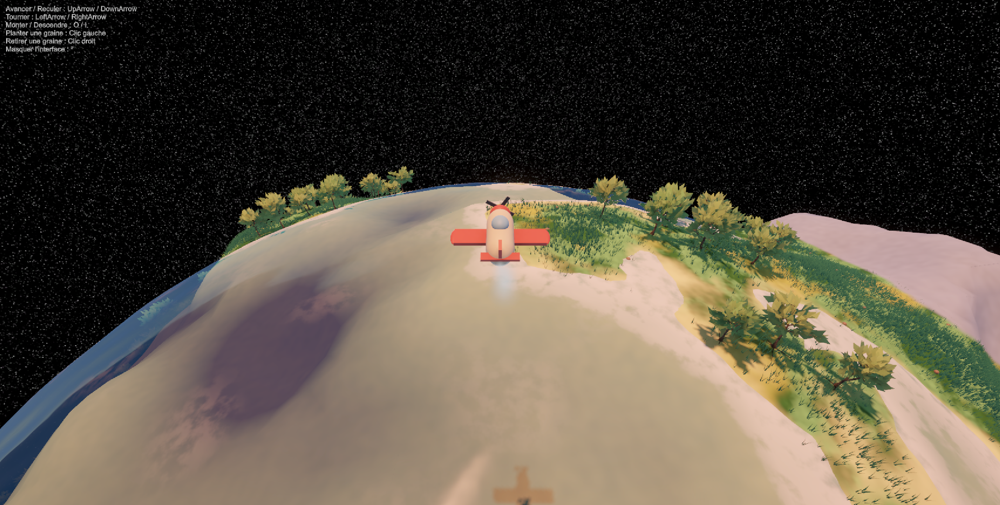
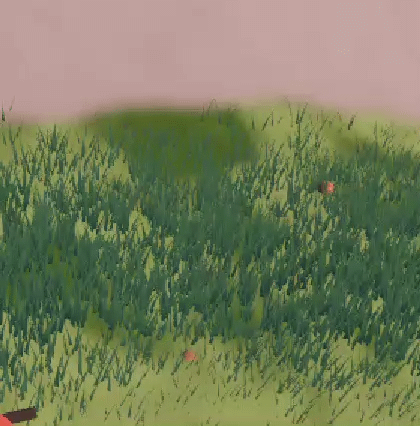
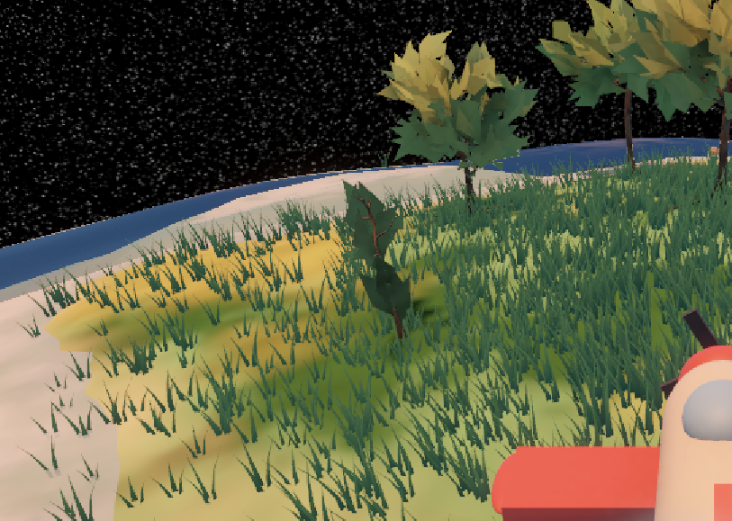
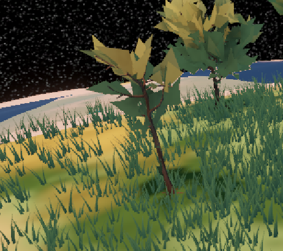
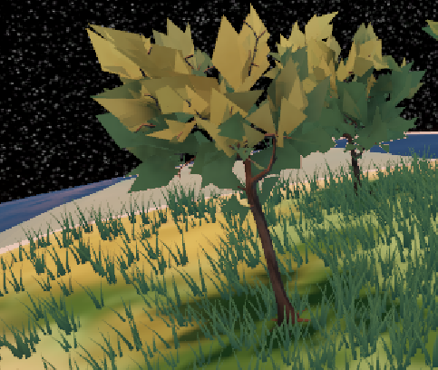
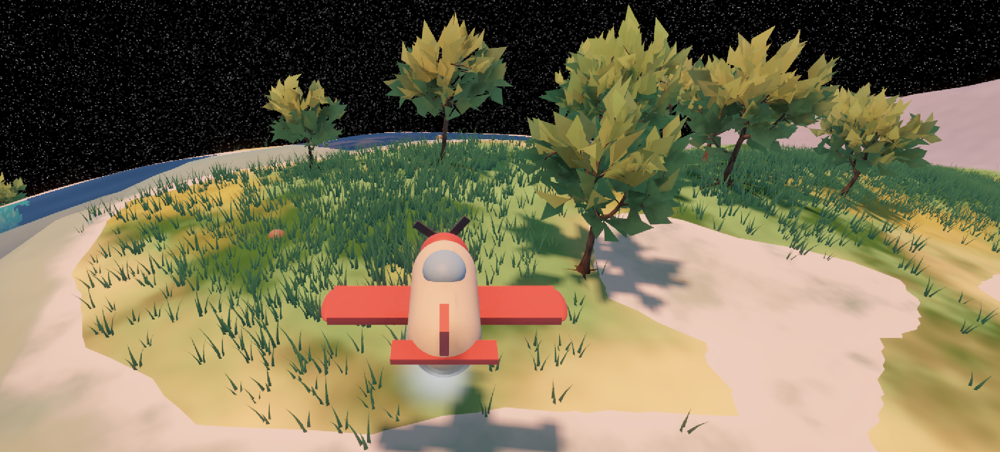
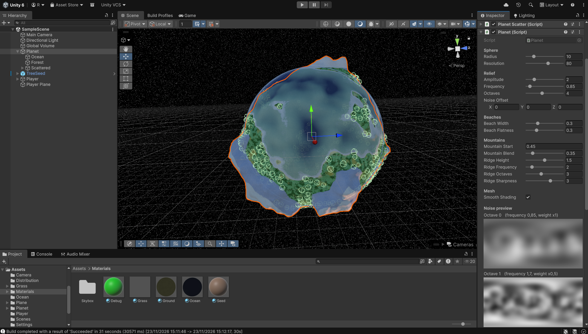
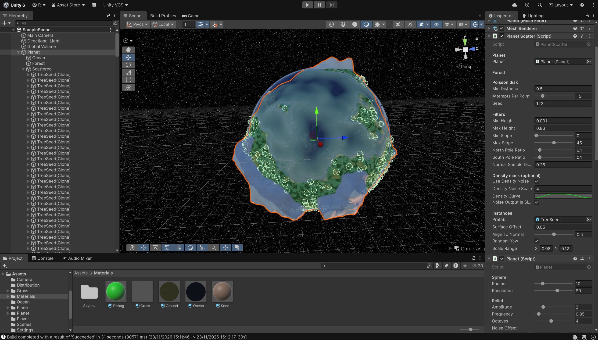

# 🌍 Procedural World Generation

A small procedural planet you fly around in a little plane, planting seeds that grow into fully procedural trees.

*ISART Digital — MGP2 · BECAUD & PIRIS · Unity 6000.3.6f1 (URP)*

## 🎬 Demo

  
   
  <em>▶ Click to watch the demo on YouTube</em>

---

## ✨ Features

### Planet
- The terrain is a **density field meshed with Marching Cubes**, built from layered 3D noise (octaves, frequency, amplitude).
- **Beaches** are flattened near sea level, and **mountains** blend in ridged noise above a height threshold.
- A separate **ocean sphere** sits on top. Everything regenerates live in the editor, with a per-octave noise preview in the inspector.

### Vegetation distribution
- Seeds are scattered with **Poisson disk sampling (Bridson's algorithm)** on the planet surface.
- Candidates are rejected based on **height, slope and pole latitude**, and the density can be modulated by a **noise mask** with a curve.
- Each instance gets a random scale, a random yaw and an adjustable alignment to the surface normal.

### Trees
- The branches are grown with the **Space Colonization** algorithm: attractor points fill a crown, and branches grow toward them.
- On top of that we add trunk flare, roots, twigs, forks, holes, leaves, and a procedural bark texture. All of it is generated as a mesh at runtime.
- Tree generation runs through a **time-budgeted scheduler** (a few ms per frame), so planting many trees doesn't freeze the game.

### Seeds & growth
- Activating a seed plants a tree that **grows from a sapling** while the seed shrinks away.
- The seed's activation sphere slowly expands and **wakes up neighbouring seeds**, so the forest spreads across the planet over time.

  
  

  
  
  

### Grass
- The grass blades are drawn with **GPU instancing** from a `GraphicsBuffer`, split into chunks with **frustum culling** and fading with distance.

---

## 🎮 Controls

| Action | Key |
|---|---|
| Move forward / backward | `↑` / `↓` |
| Turn | `←` / `→` |
| Climb / descend | `O` / `I` |
| Plant a seed | Left click |
| Remove a seed | Right click |
| Hide the controls overlay | `²` (or `` ` ``) |

> We use the arrows and `I` / `O` on purpose: they sit in the same place on QWERTY and AZERTY keyboards.

An alternative **orbit camera** (`PlanetOrbitCamera`) is also included. With it, the arrows rotate around the planet and `I` / `O` zoom in and out.

---

## 🛠️ In the editor

Every generation parameter is exposed in the inspector and updates the planet live.

  
  

---

## 📁 Project structure

| Folder | Content |
|---|---|
| `Assets/Planet` | Planet mesh (Marching Cubes, noise, relief) |
| `Assets/Ocean` | Ocean sphere |
| `Assets/Distribution` | Poisson disk scattering of the seeds |
| `Assets/TreeSeed` · `Assets/Player` | Seed activation and propagation, mouse picking |
| `Assets/Tree` | Procedural tree generation (space colonization, meshes, growth, scheduler) |
| `Assets/Grass` | GPU instanced grass |
| `Assets/Plane` · `Assets/Camera` | Player plane, orbit camera, controls overlay |
| `Assets/Shaders` | Ground and ocean shaders |

Open `Assets/Scenes/SampleScene` and press Play.
